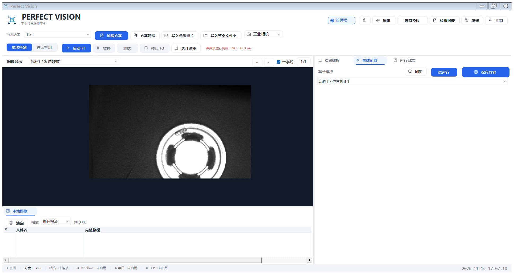
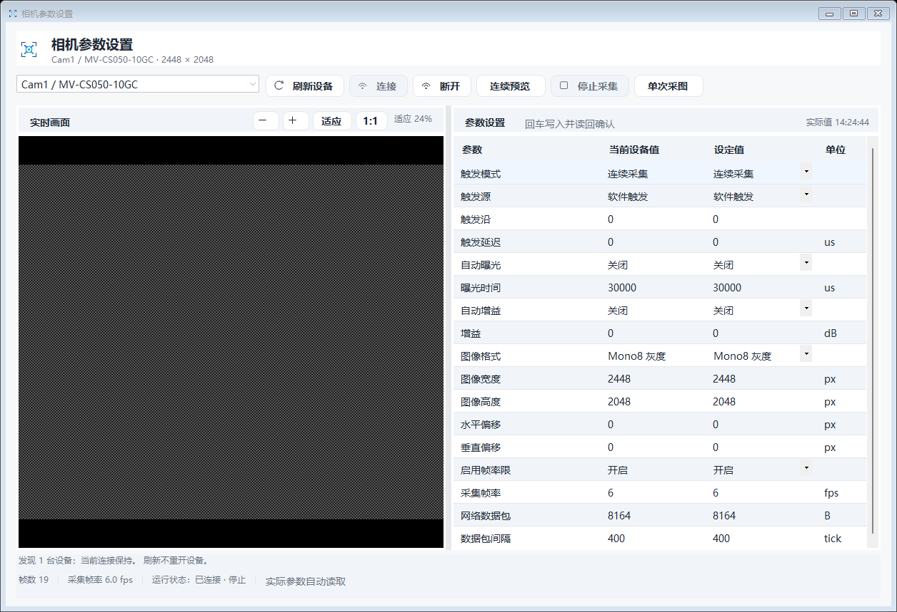
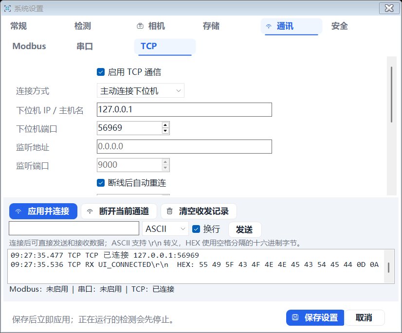

# Perfect Vision

一个用 C# 写的工业视觉上位机。底层跑海康机器人 VisionMaster 4.3 的 `.sol` 方案，外面套一层适合产线用的界面：加载方案、接相机、跟 PLC 通讯、把检测结果和图片存下来。



上面是主界面。左边是 VM 的渲染控件，右边是结果、参数、日志三个页签。截图跑的是我平时调试用的方案（一个金属环的定位加圆查找），NG 是故意挑的缺陷件，不是摆拍。截图时没接相机，状态栏显示“相机未连接”是正常的。

## 为什么会有这个东西

VisionMaster 客户端功能很全，但产线不会让操作员直接开它。操作员只需要三件事：选方案、按启动、看 OK 还是 NG。其余的加载路径、相机参数、PLC 地址、数据存哪，最好都锁死。

我一开始的想法很简单，给 VM 套个壳就行。真做起来才发现壳也不好套：VM 的渲染控件是原生的，参数编辑器是 WPF，流程对象不是线程安全的，方案加载和释放有严格顺序，相机回调也不能在 UI 线程上磨蹭。这个项目基本就是围着这几个问题长出来的。

## 界面

### 主界面和检测

主界面左边是图像区。VM 的 `VmRenderControl` 负责画图、ROI 和结果，我没有重画这一块，只在上面加了一层透明窗口画十字线、坐标和大号的 OK/NG。缩放、平移还是 VM 自己处理。

右边三个页签：结果数据是流程输出和模块输出，参数配置嵌的是 VM 官方参数编辑器，运行日志是系统日志和检测日志的尾部。

检测只有两种模式，单次和连续。F1 启动，F3 停止，暂停之后可以继续。状态栏那一排放的是相机、Modbus、串口、TCP 的实时状态，现场出问题先看这一排，比翻日志快。

判定逻辑在 `ResultJudge` 里。优先找流程输出里名字叫“检测结果”的字符串，比较 OK/NG；没有这个输出就扫全部文本，任何一个 NG 都判 NG；最后才退到 `Procedure.IsRunOK`。这么排是因为现场见过太多方案没配流程输出，直接看 `IsRunOK` 会漏判。

### 相机



截图里是 MV-CS050-10GC，2448×2048，Mono8，参数停在停止采集的状态。

相机用的是海康 MVS SDK。左边预览，右边是参数表：触发模式、触发源、曝光、增益、像素格式、包长、帧率这些。改完按回车写入，下面会显示实际回读值。

这里有一个我踩过的坑：早期版本写曝光失败被 `TrySetFloat` 吞掉了，界面显示 5000 us，相机其实还在自动曝光，图像一亮一暗，查了半天。现在写入之后一定回读，对不上就抛 `CameraSdkException`，宁可让操作员看见报错，也不假装成功。

### 通讯



截图是本机回环测试（127.0.0.1），不是现场 PLC，所以地址和端口看着像随手填的。

通讯分三个页签：Modbus TCP、TCP、串口。Modbus 只做了 FC03 读保持寄存器和 FC16 写多寄存器，够接常见的 PLC；TCP 既能主动连上位机，也能监听产线的触发；串口支持 ASCII 和 HEX 两种命令格式。

配置改完点应用，会先停检测，再重建连接，失败就回滚旧配置。这个顺序不能反，检测跑着的时候直接换通讯参数，结果会写到一半丢一半。

### 参数


参数页嵌的是 VM 官方的 `VmParamsConfigControl`，不是我画的。位置修正的输入绑定、模板、ROI 都还是 VM 自己那套，我只做了宿主、布局和权限控制。

只有管理员、并且检测处于空闲状态时才允许改。检测中改参数，轻则下一次运行不生效，重则原生层直接崩，进程都没了。

## 技术栈，以及为什么这么选

### .NET Framework 4.7.2，没追 .NET 8

不是不想用新东西。VM 4.3 的托管程序集和 WinForms 控件都是按 .NET Framework 编译的，换到 .NET 6/8 要么加一层 COM 宿主，要么等海康出新版本。工控机上多一层就多一个故障点，所以老老实实 4.7.2。

平台锁死 x64，`Directory.Build.targets` 里写了检查，AnyCPU 和 x86 直接编译不过。VM 的算法模块是 64 位原生库，32 位进程加载会 `BadImageFormatException`，与其到现场报错，不如在编译时就拦住。

### VM 4.3：所有调用挤到一根 STA 线程

VM 的方案、流程、模块参数都不是并发安全的，底层还有 COM 和原生组件。我的做法是开一根 STA 线程，建一个隐藏的消息窗口，跑 WinForms 消息泵，所有 VM 调用通过 `Control.BeginInvoke` 排队进去。加载方案、跑流程、读参数、保存、关闭，全走这一根线程。

一开始我按官方示例用了 `SyncRun()`。测试方案没事，换到现场一个模块比较多的方案，点启动界面就卡住，日志停在 `Run()` 那一行。后来才搞明白，`SyncRun()` 会占住需要处理消息的 STA，VM 内部的消息泵转不起来，自己等自己。

现在改成 `Run()` 加完成回调：STA 线程只负责 `SetImageData` 和 `Run()`，然后立刻返回消息泵；普通线程用 `TaskCompletionSource` 等 `OnWorkEndStatusCallBack`；回调到了再回 STA 读 `ModuResult`、释放 `ImageBaseData`。另外加了一个 `RunTimeoutMs`，默认 30 秒，超时只标记异常，不强行释放方案，因为迟到回调回来再释放会直接访问已销毁的原生对象。

### 相机：MVS SDK

相机这块没什么花活，就是 `MV_CC_EnumDevices_NET`、`MV_CC_OpenDevice_NET`、`MV_CC_RegisterImageCallBackEx_NET` 这一套。回调里只做三件事：拷贝帧、唤醒等待的检测线程、按抽帧间隔发预览。算法和 UI 都不进回调，回调线程一堵就开始丢帧。

曝光、增益、触发源这些参数，写入后统一 `MV_CC_GetFloatValue_NET` 回读。相机型号和固件会量化数值，回读对不上是正常的，日志里记差异，不把它当失败。

掉线重连是单独一个监控线程，按配置间隔查 `MV_CC_IsDeviceConnected_NET`。拔网线、拔 USB 都试过，能自己回来，但正在跑的那一轮检测会失败，这是预期内的。

### 通讯：没上 NModbus

Modbus TCP 是自己写的，裸 TCP 加手写 MBAP/PDU。原因很实际：少一个第三方 DLL，现场就少一个版本冲突和审批的麻烦；协议真出问题，报文不长，自己写的反而好查。

停止的时候有一个坑：读线程阻塞在 socket 上，`CancellationToken` 取消不了。现在的做法是停止时直接关掉这次连接的 socket，让阻塞读抛出来，再等线程退出。连接不能复用，下次重连重新建。

TCP 触发最多接 32 个客户端，每行 4096 字节，命令按行解析。串口就是 `System.IO.SerialPort`，ASCII 和 HEX 两套编解码。每个通道独立捕获异常、独立重连，PLC 挂了不影响本地判定和记录，只影响产线联锁，这个边界要提前跟自动化的人说清楚。

### 数据：CSV、PNG、XLSX，没上数据库

检测记录按天写 CSV，一行一次检测，字段固定，出问题可以直接用记事本打开。图片按 `年/月/日/OK|NG` 存 PNG，走一个有界队列加单写线程，队列满了丢图但保留记录，不会把检测拖死。

报表是手写的 OpenXML。对，就是自己拼 `[Content_Types].xml`、`workbook.xml`、`sheet1.xml`，再用 `ZipArchive` 打包。听起来土，但工控机不一定装 Office，引 ClosedXML 又要多带一堆 DLL，这样最省事。

没上 MySQL，也没上 SQLite。这个项目的量级用文件足够，备份就是拷目录，现场不需要再维护一个数据库服务。

### 界面：WinForms 为主，WPF 只做宿主

主界面、设置、登录都是 WinForms，控件基本是自绘的，日夜主题在 `Theme.cs` 和 `Theme.Animation.cs` 里。VM 的参数编辑器是 WPF，所以用 `ElementHost` 把它嵌进来，工程里引了 `PresentationCore`、`PresentationFramework`、`WindowsBase`，仅此而已。

透明叠加层是另一个坑。我一开始拿一个半透明的 WinForms 子控件盖在 `VmRenderControl` 上，结果整块变黑，VM 的原生渲染直接被挡住。后来改成独立的顶层窗口，`TransparencyKey` 加 `WS_EX_TRANSPARENT`、`HTTRANSPARENT`，视觉上透明、鼠标透传，缩放平移还是底下 VM 控件收到。

### 打包：WiX Burn

交付给客户的是一个 EXE 安装包，实际上是 WiX Burn 的引导程序：先检查 .NET Framework、VC++ 运行库、MVS 相机驱动，再装客户端 MSI。安装包不在这里，仓库只放源码。

发布版还做了程序集混淆和签名，这部分也不在公开仓库，原因下面说。

## 几个现在还记得的坑

**`Environment.TickCount` 会翻转。** 预览节流最早用它算间隔，理论上 24.9 天符号位翻转；这种 bug 在产线上就是第 25 天突然冻住，很难查。后来换成 `Stopwatch` 的单调计数，不想赌。

**配置热更新要先停检测。** 一开始觉得改通讯参数而已，直接换就行，结果检测线程还在写结果，旧连接已经关了。现在统一走“停检测 → 应用 → 失败回滚 → 保存配置”的顺序。

**用户库损坏不能静默重建。** 读 `users.json` 失败就重新生成默认账号，等于把现场账号洗了。现在的做法是备份坏文件、拒绝启动认证，让人来处理。

**方案没配流程输出时，`IsRunOK` 不可靠。** 有些方案所有模块都成功，但流程输出没配，`IsRunOK` 是 false。现在会退到模块汇总状态，界面上标“模块状态”，让人知道这个 OK 是从哪来的。

## 代码结构

```
VisionInspect.sln
src/
  VisionInspect.Core            模型、接口、检测状态机、判定、统计
  VisionInspect.Infrastructure  JSON 配置、日志、CSV、XLSX、图片归档
  VisionInspect.VisionMaster    VM 适配、STA 调度、参数、输出解析
  VisionInspect.Cameras         MVS 相机、回调、重连
  VisionInspect.Communication   Modbus、TCP、串口
  VisionInspect.App             WinForms 界面、启动和退出
  XVision.Sdk                   不带界面的检测 SDK
tests/                          回归程序
scripts/                        构建、发布、回归脚本
deployment/                     运行环境检查和授权方式选择
docs/                           架构、实现笔记、操作、部署、验证
```

依赖方向是单向的：`App → 适配层/基础设施 → Core`。Core 不引任何 SDK，也不引 WinForms，这样核心状态机和判定逻辑可以单独跑回归，不需要装 VM。

## 编译和运行

需要 VS2022 的 .NET 桌面开发工作负载、.NET Framework 4.7.2 开发包、VisionMaster 4.3.0 x64 和 MVS SDK。VM 的路径通过 `VisionMasterRoot` 传，MVS 通过 `MvsSdkDir` 传，脚本会自己找。

```powershell
.\scripts\Build.ps1 -Configuration Release `
  -VisionMasterRoot 'D:\Program Files\VisionMaster4.3.0' `
  -MvsSdkDir 'C:\Program Files (x86)\MVDAlgorithmSDK\ReferencedAssemblies'

& '.\src\VisionInspect.App\bin\Release\XVision.exe' '--data=D:\PerfectVisionData'
```

第一次启动会生成配置。演示账号 `admin / admin` 和 `operator / 123456`，部署前必须改。管理员密码目前是明文存在配置里，这一点在 `SECURITY.md` 里写清楚了，不算企业级认证。

不想装 VM 也能跑核心回归：

```powershell
.\scripts\Test-Core.ps1 -Configuration Release
.\src\VisionInspect.Communication\Tests\Run-Regression.ps1 -Configuration Release
```

## 现在能做什么，不能做什么

能做：加载和切换 `.sol`、单次/连续检测、暂停继续停止、MVS 相机采集和参数、Modbus TCP/TCP/串口、CSV/PNG/XLSX 归档、独立 SDK 调用。

不能做，或者没做完：

- 检测引擎只有 VM。HALCON、OpenCV 都没接，源码里留了 `IAlgorithmEngine` 抽象，但只有 `VmAlgorithmEngine` 一个实现。
- Modbus 只有 TCP FC03/FC16，没有 RTU。串口通道不等于 Modbus RTU，现场别混。
- 没有 MES、HTTP 上传、数据库。数据都在本地。
- 真实产线的相机、PLC、168 小时拷机还没做完。仓库里的验证记录只能说明软件在测试环境下跑过，不能替代现场验收。
- 无 USB 狗的运行还没验收。现在的成功记录是在 USB 授权下跑的。

## 命名和仓库

产品叫 Perfect Vision，但 exe 和程序集还叫 `XVision`。不是懒得改：现场注册表、数据目录、授权文件、一堆脚本都按 `XVision` 写死了，改一次升级会炸。所以对外统一 Perfect Vision，内部的 `XVision.exe`、`XVision.Sdk.dll` 不动，看到的时候别觉得奇怪。

仓库里是应用主线源码。5.0.4 交付包里还有相机控制窗、WPF 参数宿主、设备授权、加密方案包、安装包和签发工具，这些要么依赖商业授权代码，要么带私钥，不往公开仓库放。

## 文档

- [实现笔记：VM / MVS / 通讯 / 数据](docs/TECH_STACK.md)
- [架构与线程模型](docs/ARCHITECTURE.md)
- [操作指南](docs/USER_GUIDE.md)
- [通讯与配置即时应用](docs/COMMUNICATION_LIVE_SETTINGS.md)
- [SDK 与运行授权](docs/SDK_RUNTIME_DEPLOYMENT.md)
- [主题切换透明覆盖层问题复盘](docs/THEME_OVERLAY_FIX.md)
- [第三方依赖与许可边界](THIRD_PARTY_NOTICES.md)

仓库没有加开源许可证，源码可见不等于可以随便商用。第三方算法、商标和运行库按各自条款来。
