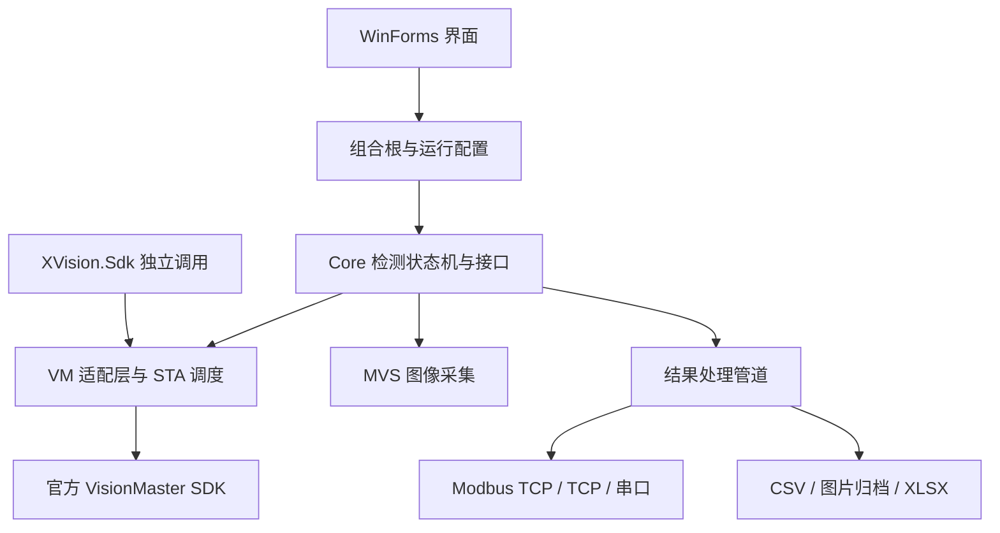

# Perfect Vision

Perfect Vision 是基于海康机器人 **VisionMaster 4.3 SDK** 二次开发的工业视觉检测上位机。它用 C# / .NET Framework 4.7.2 / WinForms 替代 VM 客户端承担产线侧工作：加载并运行 `.sol` 方案、接入工业相机、对接 PLC 与下位机、归档检测数据，并以独立 SDK 形式向其他程序开放检测能力。

**技术栈**：C# 7.3 · .NET Framework 4.7.2 · Windows x64 · WinForms（自绘主题 + WPF 互操作）· VisionMaster 4.3 SDK（STA 串行调度）· MVS SDK · Modbus TCP / TCP / 串口 · CSV / PNG / XLSX / JSON。

> **命名说明**：产品名为 **Perfect Vision**。为兼容既有现场部署、设备授权、注册表项与自动化脚本，可执行文件与程序集继续沿用 `XVision.*` 命名，例如 `XVision.exe`、`XVision.Sdk.dll`。仓库内 `VisionInspect.*` 为工程命名空间。

## 技术栈总览

| 层次 | 采用技术 | 关键落地 |
| --- | --- | --- |
| 语言与运行时 | C# 7.3、.NET Framework 4.7.2、x64 | 七个工程分层；`Directory.Build.targets` 强制 x64 / 4.7.2，禁止 AnyCPU 与 Prefer32Bit |
| 桌面界面 | WinForms、WPF 互操作（ElementHost，交付版参数编辑器宿主）、GDI+ 自绘、PerMonitorV2 DPI | 日夜主题、圆角按钮/分段控件/自绘页签、无边框窗口、十字线透明叠加层 |
| 视觉引擎 | HIKROBOT VisionMaster 4.3.0 SDK：`VM.Core`、`VM.PlatformSDKCS`、`VMControls.Winform.Release`、`ImageSourceModuleCs`、`FormatModuleCs` | 方案加载/切换/保存、SDK 注图、`Run()` + 完成回调、流程/模块输出解析、官方参数编辑器 |
| 线程模型 | 专用 STA 线程 + WinForms 消息泵、`Task` / `SemaphoreSlim` / `TaskCompletionSource` | VM 对象全部串行访问；检测、相机、通讯、归档均不占用 UI 线程 |
| 图像采集 | HIKROBOT MVS SDK：`MvCameraControl.Net`、`MVDCore.Net`、`MVDImage.Net` | 设备枚举、连接、回调取图、软/硬触发、曝光增益写入并回读、掉线自动重连 |
| 设备通讯 | 自研 Modbus TCP 主站（FC03/FC16）、TCP 触发服务、`SerialPort` | 通道隔离、自动重连、检测中在线改配置、结果寄存器映射、ASCII/HEX 命令 |
| 数据与报表 | JSON（`JavaScriptSerializer`）、CSV、PNG、OpenXML XLSX（`ZipArchive`） | 有界图片队列 + 单写线程、按日检测日志、批次报表、不依赖 Office/COM |
| 工程与交付 | MSBuild / VS2022、PowerShell、Python ReportLab、WiX v6 Burn、Obfuscar | 构建与回归脚本、MSI + 引导程序安装包、发布签名与完整性校验 |
| 质量保障 | 自研回归宿主、GitHub Actions（windows-latest） | 无 SDK 的核心/通讯回归常驻 CI；VM、相机与授权相关验证需本机官方环境 |

本仓库公开**应用核心源码**：Core、Infrastructure、VisionMaster 适配、Cameras、Communication、App 与独立 SDK。仓库是应用主线源码快照，不等同于 5.0.4 完整交付树；交付版的相机控制窗、WPF 参数编辑器宿主等界面模块，以及设备授权、方案包加密、安装包与签发工具，未纳入本仓库。

## 功能

| 范围 | 已实现内容 |
| --- | --- |
| 方案与检测 | `.sol` 加载/切换/保存，单次与连续检测，暂停/继续/停止，输出解析与 OK/NG 判定 |
| 参数与模板 | 嵌入 VM 官方参数编辑器，支持位置修正、匹配、直线/圆查找等模块的 ROI、模板与输入绑定；标量参数预设 |
| 图像输入 | 单张图片、整个文件夹导入，顺序/循环播放；MVS 相机枚举、连接、触发及参数写入 |
| 界面 | 日夜主题、图标式切换、自绘控件及统一 Logo，VM 原生图像与参数控件嵌入 |
| 通讯 | Modbus TCP FC03/FC16；TCP 主动连接/监听与结果模板；串口 ASCII/HEX；收发调试 |
| 配置 | 通讯独立于检测连接；业务配置应用后无需重启，失败报错并尝试恢复旧配置 |
| 数据 | 线程安全统计、有界异步图片归档、按日 CSV、无 Office 依赖的 XLSX 报表、审计日志 |
| SDK 与部署 | `XVision.Sdk` 独立调用、运行环境诊断、官方依赖检查和部署辅助脚本 |

## 架构



界面、检测流程、设备适配和存储分层。VM 对象交给专用 STA 线程及消息泵串行访问；检测采用 `Run()` + `OnWorkEndStatusCallBack`，避免 `SyncRun()` 阻塞 SDK 消息泵。结果处理、归档与通讯在后台任务执行，任一后处理失败都不会改写已产生的 OK/NG。

## 快速开始

1. Windows x64 上安装 VS 2022 的“.NET 桌面开发”工作负载和 .NET Framework 4.7.2 开发包。
2. 安装官方 VisionMaster 4.3.0 开发环境及相机 SDK，并准备覆盖方案算法的有效 VM 授权。
3. 在仓库根目录使用 PowerShell 构建：

```powershell
.\scripts\Build.ps1 -Configuration Release `
  -VisionMasterRoot 'D:\Program Files\VisionMaster4.3.0' `
  -MvsSdkDir 'C:\Program Files (x86)\MVDAlgorithmSDK\ReferencedAssemblies'
& '.\src\VisionInspect.App\bin\Release\XVision.exe' '--data=D:\PerfectVisionData'
```

首次运行生成本地配置。演示账号为 `admin / admin` 与 `operator / 123456`；部署前修改密码。当前管理员密码按本地配置明文保存，详见 [安全说明](SECURITY.md)。

在 VM 编辑器中验证自己的方案，打开 Perfect Vision 后加载 `.sol`，导入本地图片并执行单次检测。相机与下位机联调前，先在本地图片模式确认方案输出、判定和数据记录。

详细路径配置和发布步骤见 [构建与部署](docs/DEPLOYMENT.md)。

## 仓库导航

```text
VisionInspect.sln       解决方案，保留现有内部命名
src/                   Core、Infrastructure、VisionMaster、Cameras、Communication、App、XVision.Sdk
config/                脱离现场配置的示例
samples/               SDK 调用代码与合成图片
scripts/               构建、发布和回归入口
tests/                 回归测试程序
deployment/            环境检查与官方授权方式选择辅助脚本
docs/                  架构、技术栈、操作、SDK、验证与已知边界
```

## 验证

不需要 VM 运行授权的核心与通讯基础回归：

```powershell
.\scripts\Test-Core.ps1 -Configuration Release
.\src\VisionInspect.Communication\Tests\Run-Regression.ps1 -Configuration Release
```

完整 GUI、SDK 与集成测试需要本机官方 SDK；真实算法测试还需要有效许可。历史验证记录与本次文档整理结果见 [验证矩阵](docs/VERIFICATION.md)。GitHub Actions 仅执行无需海康库的核心与通讯基础回归，完整软件不能在没有官方 SDK 的环境中构建。

## 使用范围

- 本次分析的 Perfect Vision 5.0.4 交付版检测引擎为 VisionMaster，未集成 HALCON、OpenCV 或自研替代算法；仓库保留 `IAlgorithmEngine` 抽象以便扩展。
- `.sol` 需要匹配的官方 VM 运行库与有效许可，二次开发不改变官方授权条件。
- 数据归档使用本地 JSON / CSV / PNG / XLSX，不依赖 MySQL、SQL Server 或 Office；本仓库不含数据库服务端实现。
- Modbus 仅实现 TCP FC03/FC16；串口通道不等于 Modbus RTU。
- 本机模拟端点测试不能替代现场 PLC、串口设备和工业相机验收。
- 当前成功执行记录基于 USB 授权；无 USB 运行仍需合适的官方授权并另行验证。
- 日夜切换已有连续 20 次回归记录；未作零故障或所有负载下零卡顿承诺。

## 文档

- [技术栈与实现分析](docs/TECH_STACK.md)
- [架构与线程模型](docs/ARCHITECTURE.md)
- [操作指南](docs/USER_GUIDE.md)
- [通讯与配置即时应用](docs/COMMUNICATION_LIVE_SETTINGS.md)
- [SDK 与运行授权](docs/SDK_RUNTIME_DEPLOYMENT.md)
- [主题切换透明覆盖层问题复盘](docs/THEME_OVERLAY_FIX.md)
- [第三方依赖与许可边界](THIRD_PARTY_NOTICES.md)

仓库展示源码，不预设开源许可；未附许可证的使用权限不因源码可见而扩大。第三方算法、商标及运行库遵循其各自条款。

## 界面预览

以下为隔离测试配置下的真实设置窗体。主界面操作和原生图像显示验证见验证矩阵。

| 白天 | 夜间 |
| --- | --- |
|  |  |
