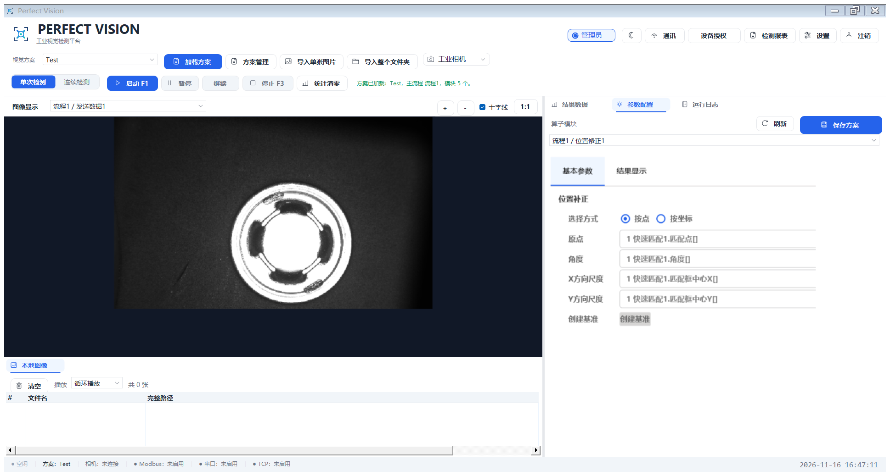

# Perfect Vision

Perfect Vision 是一套采用 C# 开发的工业视觉上位机软件。软件以海康机器人 VisionMaster 4.3 作为算法执行引擎，在其上实现面向产线的操作界面，功能包括方案加载与运行、工业相机采集、PLC 与下位机通讯、检测结果归档。


主界面左侧为 VM 渲染控件，右侧为结果数据、参数配置和运行日志三个页签。截图加载的是调试用方案，用于金属环的定位与圆查找；NG 样件为人为挑选的缺陷件，仅用于说明判定结果。截图时未连接相机，状态栏显示“相机未连接”属于正常状态。

## 项目背景

VisionMaster 客户端功能完整，但产线环境通常不允许操作员直接使用该客户端。操作员实际需要的操作只有三项：选择方案、启动检测、读取 OK/NG 结果。方案路径、相机参数、PLC 地址和数据目录等配置均应预先固定，避免现场误改。

我最初的目标是在 VM 之上封装一层操作界面。实际开发中，封装层的复杂度高于预期：VM 的渲染控件为原生实现，参数编辑器基于 WPF；方案、流程和模块对象不具备并发安全性；方案加载与释放存在严格的顺序要求；相机回调也不能被界面逻辑阻塞。当前架构主要围绕这些问题设计。

## 界面

### 主界面与检测

主界面左侧为图像区域。图像、ROI 和检测结果由 VM 的 `VmRenderControl` 绘制，本软件未重新实现该部分；在其上叠加了一个独立透明窗口，用于绘制十字线、坐标和大号 OK/NG。缩放与平移仍由 VM 控件处理。

右侧包含三个页签：结果数据展示流程输出与模块输出；参数配置嵌入 VM 官方参数编辑器；运行日志展示系统日志与检测日志的末尾部分。

检测模式分为单次与连续两种。F1 启动，F3 停止，暂停后可继续。状态栏实时显示相机、Modbus、串口和 TCP 的连接状态，现场排查时通常比查阅日志更直接。

判定逻辑位于 `ResultJudge`。优先读取流程输出中名为“检测结果”的字符串并比较 OK/NG；若方案未配置该输出，则扫描全部文本，任一 NG 即判定为 NG；最后回退到 `Procedure.IsRunOK`。采用该顺序的原因是现场存在较多未配置流程输出的方案，仅依赖 `IsRunOK` 容易产生漏判。

### 相机


截图中的相机为 MV-CS050-10GC，分辨率 2448×2048，像素格式 Mono8，参数页处于停止采集状态。

相机接入使用海康 MVS SDK。界面左侧为预览，右侧为参数表，包含触发模式、触发源、曝光、增益、像素格式、网络包长和帧率等。修改后按回车写入，界面下方显示实际回读值。

早期版本曾出现曝光写入失败被 `TrySetFloat` 静默忽略的问题：界面显示 5000 us，相机仍处于自动曝光，图像亮度反复变化，排查耗时较长。当前实现在写入后统一回读，数值不一致时抛出 `CameraSdkException`。相比静默容忍，显式报错更便于现场定位。

### 通讯


截图为本机回环测试（127.0.0.1），并非现场 PLC，因此地址与端口仅用于验证。

通讯配置分为 Modbus TCP、TCP 和串口三个页签。Modbus 实现了 FC03 读保持寄存器和 FC16 写多寄存器，可覆盖常见 PLC 的寄存器读写需求；TCP 支持主动连接上位机与监听产线触发两种模式；串口支持 ASCII 与 HEX 两种命令格式。

配置应用时先停止检测，再重建连接；应用失败则回滚至旧配置。该顺序不可颠倒。检测运行期间直接更换通讯参数，会导致部分结果写入旧连接或丢失。

### 参数



参数页嵌入的是 VM 官方 `VmParamsConfigControl`，并非自行实现。位置修正的输入绑定、模板和 ROI 仍由 VM 处理，本软件仅负责宿主、布局和权限控制。

参数修改仅允许管理员在检测空闲状态下进行。检测运行期间修改参数，轻则下一次运行不生效，重则导致原生层崩溃、进程退出。

## 技术选型

### 运行时：.NET Framework 4.7.2

选择 .NET Framework 4.7.2 而非 .NET 6/8，原因在于 VM 4.3 的托管程序集与 WinForms 控件均面向 .NET Framework 编译。迁移到更高版本的运行时需要额外的 COM 宿主层，或等待海康发布对应版本。工控机环境对依赖数量较为敏感，因此未引入额外的运行时适配层。

平台固定为 x64。`Directory.Build.targets` 在构建前校验平台与目标框架，AnyCPU 与 x86 会直接导致编译失败。VM 的算法模块为 64 位原生库，32 位进程加载时会抛出 `BadImageFormatException`；在编译阶段拦截比在现场暴露更可控。

### VM 4.3：单 STA 线程串行调用

VM 的方案、流程与模块参数不具备并发安全性，底层还涉及 COM 与原生对象。实现方式是创建一条 STA 线程，在该线程上建立隐藏消息窗口并运行 WinForms 消息泵；所有 VM 调用通过 `Control.BeginInvoke` 排队执行。方案加载、流程运行、参数读写、保存与关闭均在该线程上串行完成。

我在第一版实现中按照官方示例使用了 `SyncRun()`。该方式在测试方案上运行正常，但在模块数量较多的现场方案中，启动后界面无响应，日志停留在 `Run()` 调用处。原因是 `SyncRun()` 占用了需要处理消息的 STA 线程，VM 内部消息泵无法运转，形成对自身的等待。

当前实现改为 `Run()` 加完成回调：STA 线程仅执行 `SetImageData` 与 `Run()`，随后立即返回消息泵；普通线程通过 `TaskCompletionSource` 等待 `OnWorkEndStatusCallBack`；回调到达后再回到 STA 线程读取 `ModuResult` 并释放 `ImageBaseData`。同时设置 `RunTimeoutMs`（默认 30 秒），超时仅标记异常，不强制释放方案。迟到回调仍会访问方案对象，提前释放会导致进程崩溃。

### 相机：MVS SDK

相机接入使用 `MV_CC_EnumDevices_NET`、`MV_CC_OpenDevice_NET`、`MV_CC_RegisterImageCallBackEx_NET` 等接口。回调内仅执行三项操作：拷贝当前帧、唤醒等待中的检测线程、按抽帧间隔发布预览。算法与界面逻辑均不进入回调；MVS 回调对耗时较为敏感，阻塞会导致丢帧。

曝光、增益与触发源等参数在写入后统一通过 `MV_CC_GetFloatValue_NET` 回读。不同相机型号与固件会对数值进行量化，回读值不一致属于正常现象；日志记录差异，但不将其视为写入失败。

掉线重连由独立监控线程负责，按配置间隔调用 `MV_CC_IsDeviceConnected_NET`。网线与 USB 断开的情况均已测试，连接可自动恢复；正在执行的那一轮检测会失败，属于预期行为。

### 通讯：Modbus TCP 自行实现

Modbus TCP 未引入 NModbus，采用裸 TCP 与手写 MBAP/PDU 实现。主要目的是减少第三方依赖：工控机部署环境对 DLL 版本冲突较为敏感，且协议问题出现时，自行实现的报文更便于排查。

停止时存在一个问题：读线程阻塞在 socket 上，`CancellationToken` 无法取消。当前实现是在停止时关闭本次连接的 socket，使阻塞读抛出异常，再等待线程退出。连接不可复用，重连时重新建立。

TCP 触发最多支持 32 个客户端，每行 4096 字节，按行解析命令。串口使用 `System.IO.SerialPort`，提供 ASCII 与 HEX 两套编解码。三个通道各自捕获异常并独立重连；PLC 故障不影响本地判定与记录，仅影响产线联锁。该边界需在项目初期与自动化团队确认。

### 数据：CSV、PNG 与 XLSX

检测记录按天写入 CSV，每次检测一行，字段固定，可直接用文本编辑器查看。图片按“年/月/日/OK|NG”目录保存为 PNG，写入采用有界队列与单写线程；队列满时丢弃图片但保留记录，避免影响检测节拍。

报表使用手写 OpenXML 实现：直接生成 `[Content_Types].xml`、`workbook.xml`、`sheet1.xml` 等部件，再通过 `ZipArchive` 打包为 `.xlsx`。该方式虽不如第三方库简洁，但无需安装 Office，也无需额外引入 ClosedXML 及其依赖。

数据存储未使用 MySQL 或 SQLite。当前数据量用文件系统即可满足，备份只需复制目录，现场无需额外维护数据库服务。

### 界面：WinForms 为主，WPF 仅作宿主

主界面、设置和登录窗口均基于 WinForms，控件以自绘为主，日夜主题实现在 `Theme.cs` 与 `Theme.Animation.cs` 中。VM 的参数编辑器为 WPF 实现，因此通过 `ElementHost` 嵌入，工程引用 `PresentationCore`、`PresentationFramework` 和 `WindowsBase`。

透明叠加层经历了多次调整。我最初使用半透明 WinForms 子控件覆盖 `VmRenderControl`，实际显示为整块黑色，遮挡了 VM 的原生渲染。当前改为独立顶层窗口，通过 `TransparencyKey`、`WS_EX_TRANSPARENT` 和 `HTTRANSPARENT` 实现视觉透明与鼠标透传；缩放和平移仍由底层 VM 控件接收。

### 打包：WiX Burn

交付版本使用 WiX Burn 引导程序：依次检查并安装 .NET Framework、VC++ 运行库和 MVS 相机驱动，最后安装客户端 MSI。安装包未包含在本仓库中，仓库仅提供源码。

发布版本还包含程序集混淆与签名，相关工具与密钥不在公开仓库中，具体原因见“命名与仓库”一节。

## 实现中的几个问题

**`Environment.TickCount` 的符号翻转。** 预览节流最初使用 `Environment.TickCount` 计算间隔。该值在约 24.9 天后发生符号翻转，可能导致界面冻结。当前实现改用 `Stopwatch` 的单调计数，避免依赖该行为。

**配置热更新必须先停止检测。** 早期实现直接在检测运行期间切换通讯配置，结果检测线程仍在写入结果，旧连接已被关闭。当前统一按“停止检测 → 应用配置 → 失败回滚 → 保存配置”的顺序执行。

**用户库损坏时不能静默重建。** 若读取 `users.json` 失败后重新生成默认账号，等于清除现场账号。当前实现会备份损坏文件并拒绝启动认证，由维护人员处理。

**方案未配置流程输出时 `IsRunOK` 不可靠。** 部分方案的所有模块均执行成功，但流程输出未配置，`Procedure.IsRunOK` 返回 false。当前实现会回退到模块汇总状态，并在界面标注“模块状态”，以说明判定来源。

## 代码结构

```
VisionInspect.sln
src/
  VisionInspect.Core            模型、接口、检测状态机、判定、统计
  VisionInspect.Infrastructure  JSON 配置、日志、CSV、XLSX、图片归档
  VisionInspect.VisionMaster    VM 适配、STA 调度、参数、输出解析
  VisionInspect.Cameras         MVS 相机、回调、重连
  VisionInspect.Communication   Modbus、TCP、串口
  VisionInspect.App             WinForms 界面、启动和退出
  XVision.Sdk                   不带界面的检测 SDK
tests/                          回归程序
scripts/                        构建、发布、回归脚本
deployment/                     运行环境检查和授权方式选择
docs/                           架构、实现笔记、操作、部署、验证
```

依赖方向为单向：`App → 适配层/基础设施 → Core`。Core 不引用任何 SDK，也不引用 WinForms，因此核心状态机与判定逻辑可以独立运行回归测试，无需安装 VM。

## 编译与运行

编译需要 VS2022 的 .NET 桌面开发工作负载、.NET Framework 4.7.2 开发包、VisionMaster 4.3.0 x64 与 MVS SDK。VM 路径通过 `VisionMasterRoot` 传入，MVS 路径通过 `MvsSdkDir` 传入，构建脚本会在未显式指定时自动查找。

```powershell
.\scripts\Build.ps1 -Configuration Release `
  -VisionMasterRoot 'D:\Program Files\VisionMaster4.3.0' `
  -MvsSdkDir 'C:\Program Files (x86)\MVDAlgorithmSDK\ReferencedAssemblies'

& '.\src\VisionInspect.App\bin\Release\XVision.exe' '--data=D:\PerfectVisionData'
```

首次启动会生成本地配置。演示账号为 `admin / admin` 与 `operator / 123456`，部署前必须修改。管理员密码当前以明文保存在配置中，详见 `SECURITY.md`。

未安装 VM 时也可运行核心回归：

```powershell
.\scripts\Test-Core.ps1 -Configuration Release
.\src\VisionInspect.Communication\Tests\Run-Regression.ps1 -Configuration Release
```

## 当前能力与限制

已实现：加载与切换 `.sol`、单次/连续检测、暂停/继续/停止、MVS 相机采集与参数配置、Modbus TCP/TCP/串口通讯、CSV/PNG/XLSX 归档、独立 SDK 调用。

尚未实现或未完成：

- 检测引擎仅支持 VM。HALCON 与 OpenCV 均未接入；源码保留 `IAlgorithmEngine` 抽象，但目前只有 `VmAlgorithmEngine` 一个实现。
- Modbus 仅实现 TCP FC03/FC16，未实现 RTU。串口通道不等同于 Modbus RTU，两者不应混用。
- 未提供 MES、HTTP 上传或数据库支持，数据均保存在本地。
- 真实产线的相机、PLC 联调与 168 小时连续运行测试尚未完成。仓库中的验证记录仅代表测试环境下的结果，不能替代现场验收。
- 无 USB 加密狗的运行场景尚未验收，现有成功记录均在 USB 授权条件下取得。

## 命名与仓库

产品对外名称为 Perfect Vision，但可执行文件与程序集仍保留 `XVision` 前缀。保留该命名的原因并非出于疏忽：现场注册表、数据目录、授权文件和脚本均依赖 `XVision` 标识，贸然修改会影响既有现场的升级兼容性。因此对外展示统一使用 Perfect Vision，内部的 `XVision.exe`、`XVision.Sdk.dll` 保持不变。

仓库包含应用主线源码。5.0.4 交付版本还包含相机控制窗、WPF 参数宿主、设备授权、加密方案包、安装包和签发工具；这些模块或依赖商业授权代码，或包含私钥，因此未纳入公开仓库。

## 文档

- [实现笔记：VM / MVS / 通讯 / 数据](docs/TECH_STACK.md)
- [架构与线程模型](docs/ARCHITECTURE.md)
- [操作指南](docs/USER_GUIDE.md)
- [通讯与配置即时应用](docs/COMMUNICATION_LIVE_SETTINGS.md)
- [SDK 与运行授权](docs/SDK_RUNTIME_DEPLOYMENT.md)
- [主题切换透明覆盖层问题复盘](docs/THEME_OVERLAY_FIX.md)
- [第三方依赖与许可边界](THIRD_PARTY_NOTICES.md)

仓库未添加开源许可证，源码可见并不意味着可以商用。第三方算法、商标与运行库遵循各自条款。
